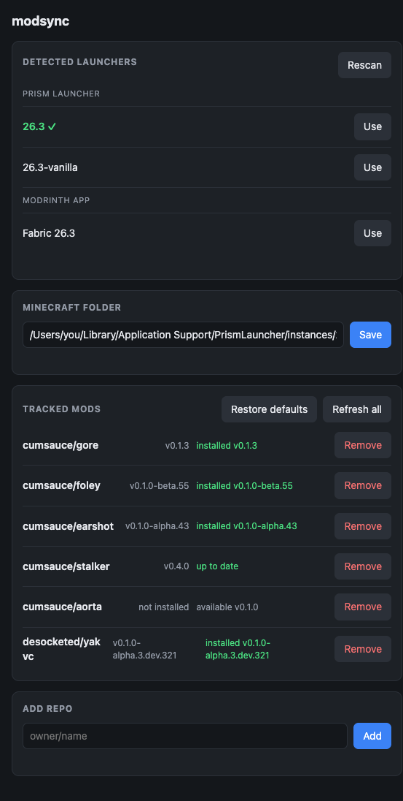

# modsync

A small native desktop app that keeps **one** Minecraft install's `mods` folder in
sync with the newest GitHub *release* jars from a configurable set of repos.

Built with [Zig](https://ziglang.org) + the vendored
[webview/webview](https://github.com/webview/webview) C library — a native OS
window (WKWebView on macOS, WebView2 on Windows, WebKitGTK on Linux) with no
bundled browser engine. Single ~1.7 MB binary (macOS, ReleaseSafe).



## Install

### Download a release

Grab the asset for your platform from the
[**Releases page**](../../releases/latest):

| Platform | Asset |
|----------|-------|
| macOS (Apple Silicon) | `modsync-macos-arm64` |
| Linux (x86_64) | `modsync-linux-x86_64` |
| Windows (x86_64) | `modsync-windows-x86_64.exe` |

The macOS binary is **unsigned**, so Gatekeeper warns on first launch. Either
right-click → Open, or:

```sh
chmod +x modsync-macos-arm64
xattr -d com.apple.quarantine modsync-macos-arm64
./modsync-macos-arm64
```

macOS and Linux assets are built and tested in CI. The Windows asset is built
and linked in CI (MSVC toolchain) but has not been runtime-tested.

### Nix (flake)

Runs on any machine with [Nix](https://nixos.org) — no manual toolchain setup:

```sh
# Run it directly
nix run github:cumsauce/modsync

# ...or from a clone
nix run .

# Development shell (zig 0.17 + GTK/WebKit deps on Linux)
nix develop
```

The flake pins `nixos-unstable` on purpose: Zig 0.17 lives there as
`pkgs.zig_0_17` (the stable branch still ships 0.16, which this project cannot
build with).


## What it does

- Point it at a Minecraft folder (e.g. `~/Library/Application Support/minecraft`).
- It tracks a list of GitHub repos and, on **Refresh**, downloads the newest
  release jar from each into `<minecraft>/mods/`.
- When it installs a new version of a mod, it removes that mod's older jars
  (`{repo}-*.jar`) and leaves every other file in `mods/` untouched.
- Already-up-to-date mods are skipped (same tag **and** the jar is present).
- Seed repos: `cumsauce/gore`, `cumsauce/foley`, `cumsauce/earshot`,
  `cumsauce/stalker`, `cumsauce/aorta`, `desocketed/yakvc` — configurable via
  `defaults.json` (see Config below), and you can add or remove any repo.
- Prereleases count (foley/earshot/yakvc are prerelease-only), so "newest" means
  the first non-draft release on the `releases?per_page=100` list.

## Build & run

Requires **Zig 0.17.0** (`brew install zig`), or use `nix develop` above.

```sh
zig build            # -> zig-out/bin/modsync
zig build test       # runs the unit tests
zig build run        # builds and launches the app
```

On Linux you also need the GTK/WebKit dev packages:

```sh
# Debian/Ubuntu
sudo apt-get install libgtk-3-dev libwebkit2gtk-4.1-dev
```

Then launch it directly:

```sh
./zig-out/bin/modsync
```

## Using the app

- **Detected launchers** — modsync finds Prism Launcher and Modrinth App installs
  automatically (macOS, Linux, Windows) and lists their instances/profiles. Hit
  **Use** on one to make it the managed game directory. Only `<profile>/mods/`
  is ever touched; launcher metadata is never written.
- **Minecraft folder** — type the path and press **Save** (manual alternative to
  picking a profile).
- **Refresh all** — fetches each tracked repo's newest release and installs it.
  Each row shows its status (installed tag / up to date / no releases / error).
- **Tracked mods** — add a repo as `owner/name`, or **Remove** one.

## Config

A JSON file, auto-created and updated:

| OS      | Path |
|---------|------|
| macOS   | `~/Library/Application Support/modsync/config.json` |
| Linux   | `~/.config/modsync/config.json` |
| Windows | `%APPDATA%\modsync\config.json` |

### Changing the default (seed) repos — no rebuild needed

Which repos a fresh install starts with lives in a **data file**, not the code:

```
<config-dir>/defaults.json      # e.g. ~/Library/Application Support/modsync/defaults.json
```

It's written on first run as a copy of the built-in list. Edit it any time, then
either delete `config.json` (to re-seed on next start) or hit **Restore defaults**
in the app to re-apply it to your current list. A bundled copy in the source
(`src/defaults.json`) is the fallback when the user file is missing or malformed,
so editing the file never requires recompiling.

```json
{ "repos": [ { "owner": "cumsauce", "name": "gore" } ] }
```

Optional: set a GitHub token in `config.json`'s `githubToken` for higher API rate limits.

## Layout

```
src/main.zig      entry point: load config -> App.init -> run
src/config.zig    Config/Repo model, JSON persistence, seeded repos, config paths
src/github.zig    release JSON parsing + deterministic jar-asset selection
src/net.zig       GitHub fetch + jar download over std.http (stdlib only)
src/install.zig   mods-folder ops: mkdir, stale-jar detection, place jar
src/app.zig       webview bridge (JS <-> Zig), background refresh worker
src/ui.html       the UI (vanilla JS, embedded via @embedFile + webview_set_html)
lib/webview/      vendored webview/webview C library (see TOOLCHAIN.md)
```

## Notes

- v1 target is macOS (verified: builds, launches, live-fetches). Path handling
  and the webview bootstrap are the only platform-specific code, so Windows and
  Linux builds are a natural next step.
- Implementation plan and design doc live under `docs/superpowers/`.
